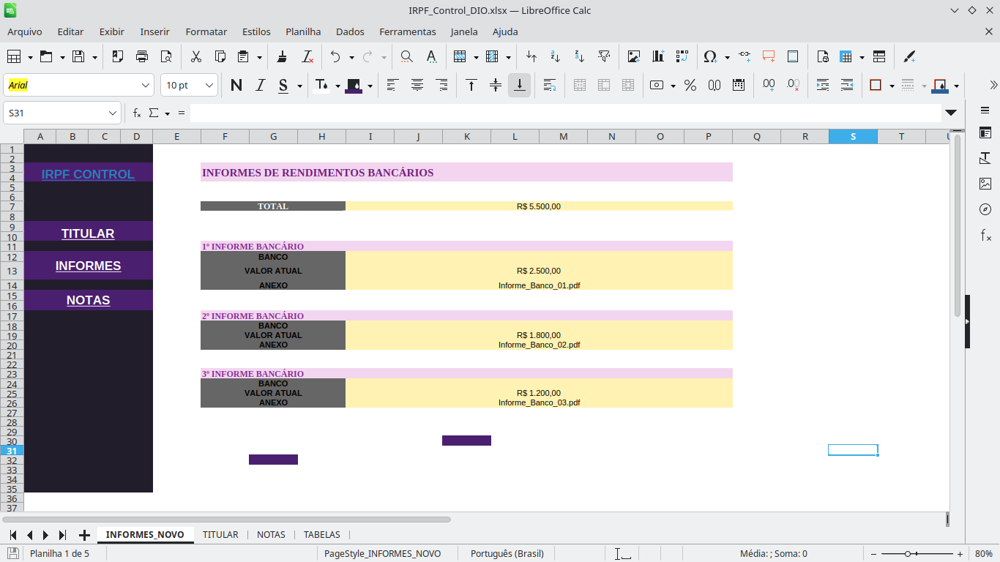
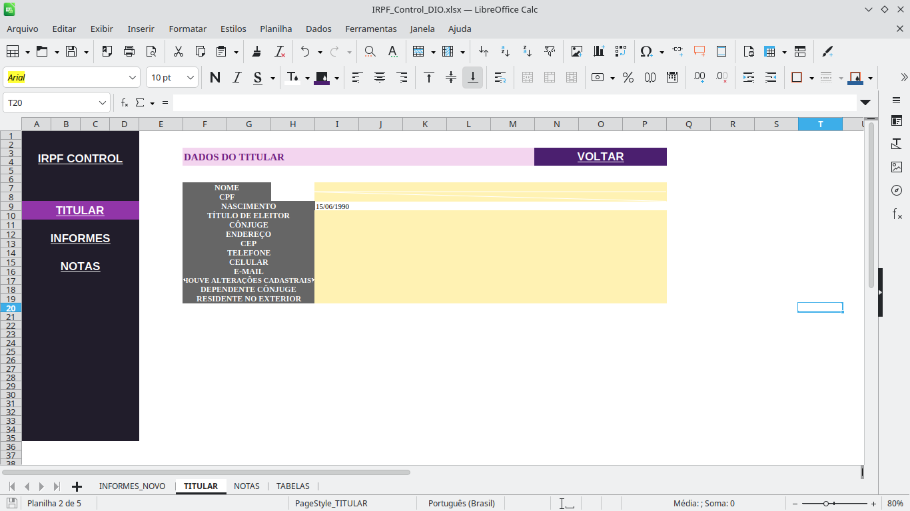
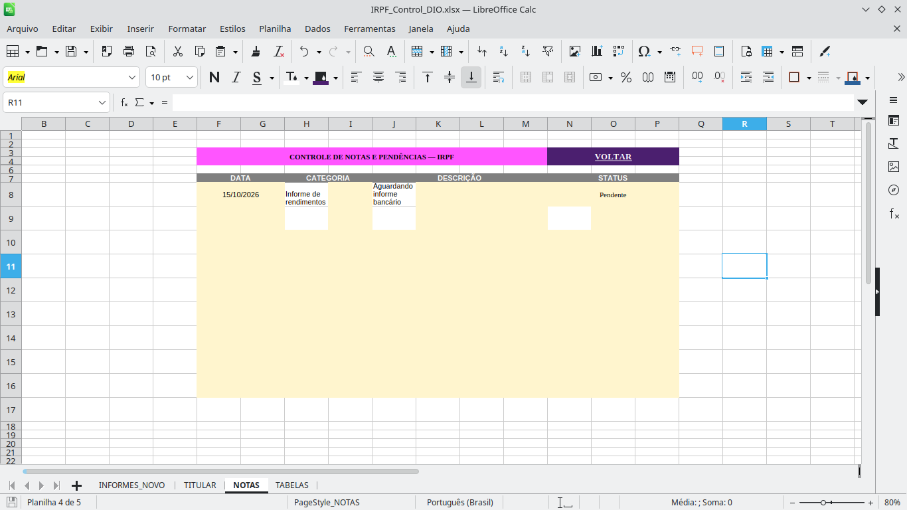

# Desafio Excel — Organizador de Declaração de Imposto de Renda

## IRPF Control | Bootcamp DIO

Projeto desenvolvido como parte de um desafio prático da **Digital Innovation One (DIO)**, com o objetivo de criar uma ferramenta de apoio à organização das informações necessárias para a Declaração do Imposto de Renda Pessoa Física (IRPF).

A solução foi construída no **LibreOffice Calc**, utilizando uma planilha no formato `.xlsx`, compatível com o Microsoft Excel.

## Objetivo do projeto

Desenvolver uma planilha organizada e de fácil utilização, permitindo centralizar informações cadastrais, informes bancários e anotações relevantes para a preparação da declaração do Imposto de Renda.

O projeto também contempla recursos de navegação, fórmulas automáticas e validação de dados.

## Funcionalidades implementadas

### 1. Cadastro do titular

A aba **TITULAR** apresenta campos destinados ao registro das informações cadastrais do contribuinte, com organização visual e navegação para outras áreas da planilha.

### 2. Controle de informes bancários

A aba **INFORMES_NOVO** permite registrar informações financeiras de três instituições bancárias.

Foi implementado o cálculo automático do total utilizando a fórmula:

```excel
=SOMA(I13;I19;I25)
```

Durante a validação do projeto, os valores de exemplo totalizaram **R$ 5.500,00**.

### 3. Controle de notas e pendências

A aba **NOTAS** foi estruturada com os campos:

- Data
- Categoria
- Descrição
- Status

O campo STATUS possui uma lista suspensa com as opções **Pendente**, **Em andamento** e **Concluído**, permitindo padronizar o acompanhamento das pendências.

### 4. Navegação entre planilhas

Foram configurados hiperlinks internos para facilitar o acesso às abas e o retorno à página principal, incluindo os botões TITULAR, INFORMES, NOTAS e VOLTAR.

### 5. Organização de tabelas auxiliares

A aba **TABELAS** contém informações auxiliares de instituições financeiras e códigos bancários.

## Evidências do projeto

### Informes bancários



### Cadastro do titular



### Controle de notas



## Testes realizados

Foram executados testes funcionais para verificar:

- Navegação entre as abas TITULAR, INFORMES_NOVO e NOTAS.
- Funcionamento dos botões de retorno.
- Cálculo automático do total dos informes.
- Atualização do total após alteração de um valor.
- Restauração dos valores originais após os testes.
- Preenchimento dos campos de notas.
- Funcionamento da lista suspensa de STATUS.
- Preservação da formatação e dos dados após a remoção de registros temporários.

Os testes descritos foram concluídos com sucesso.

## Tecnologias e ferramentas

- LibreOffice Calc
- Planilhas Excel (`.xlsx`)
- Fórmulas de planilha
- Validação de dados
- Hiperlinks internos
- Visual Studio Code
- Git e GitHub

## Estrutura do repositório

```text
desafio-excel-irpf/
├── IRPF_Control_DIO.xlsx
├── README.md
└── images/
    ├── 01-informes-bancarios.png
    ├── 02-dados-titular.png
    └── 03-controle-notas.png
```

## Como utilizar

1. Baixe o arquivo `IRPF_Control_DIO.xlsx`.
2. Abra-o no LibreOffice Calc ou em uma versão compatível do Microsoft Excel.
3. Utilize os botões de navegação para acessar as seções.
4. Preencha os dados cadastrais e os informes bancários.
5. Utilize a aba NOTAS para registrar e acompanhar pendências.

**Observação:** a planilha é uma ferramenta de organização e não substitui o programa oficial da Receita Federal nem a conferência das informações fiscais.

## Aprendizados

O desenvolvimento deste projeto permitiu aplicar conhecimentos de estruturação de planilhas, automação de cálculos, validação de dados, organização visual e testes funcionais.

Também proporcionou experiência prática na documentação de projetos e na preparação de entregas para um portfólio no GitHub.

---

**Projeto desenvolvido para fins educacionais — Desafio DIO.**